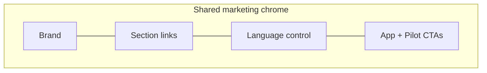
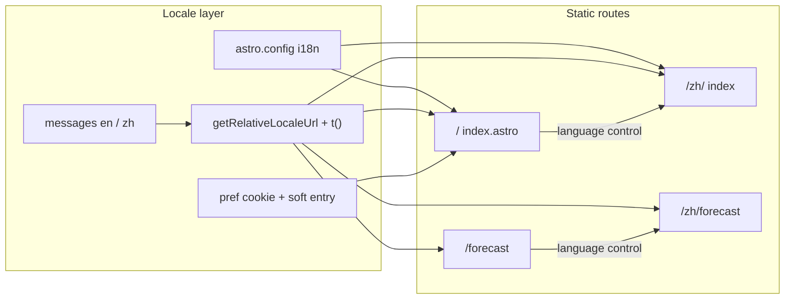

# Marketing Site Bilingual Locale (EN + 简体) - Plan

## Goal Capsule

- **Objective:** Make the public marketing site fully usable in Simplified Chinese so Chinese-speaking prospects can understand Color Brain and request a pilot without English.
- **Product authority:** This plan owns **marketing-site localization only** (`landing/`: home, forecast, shared chrome). Product-app localization is surrounding work, not active scope.
- **Product Contract preservation:** Product Contract unchanged (R1–R15, A/F/AE IDs stable). Planning sections add HOW only.
- **Open blockers:** None.
- **Execution profile:** Implement in `landing/` only; verify with `npm run build` (astro check + build) and scenario smoke against built routes.
- **Stop conditions:** Stop if scope expands into `app/` localization, Traditional Chinese, or browser auto-detect — those remain deferred product decisions.

---

## Product Contract

### Summary

Ship a full bilingual marketing experience in English and Simplified Chinese (简体中文) with a visible language control.
Chinese content lives on dedicated locale URLs; English remains the default first-visit language; an explicit choice is remembered on the soft entry only (deep locale URLs always win).
Prospects must be able to complete the full marketing story — including the forecast path — and request a pilot in Chinese.

### Problem Frame

Clients and prospects have asked for Chinese on the public site.
Today the marketing package is English-only: document language is `en`, copy is hardcoded in components, and there is no locale routing or language control.
Chinese-speaking decision-makers who land on the site cannot self-serve the product story; sales and pilots absorb translation burden offline.
The signed-in product app is a separate English surface; this brief does not remove that gap, but marketing is where first trust and pilot intent form.

### Key Decisions

- **Marketing site only in v1** — product app stays English. (session-settled: user-directed — chosen over app-only or both-together: ship where prospects self-serve the story first) Governs R1, R13.
- **Simplified Chinese only** — no Traditional Chinese in v1. (session-settled: user-approved — chosen over Traditional-only or both: core market assumed mainland / 简体) Governs R2.
- **Full site bilingual** — home, forecast, and shared chrome, not a partial homepage pack. (session-settled: user-approved — chosen over homepage-only or Chinese sales pack: self-serve whole story) Governs R3, R4.
- **Locale URLs + language control** — parallel Chinese paths rather than same-URL client-side string swap. (session-settled: user-approved — chosen over client-side swap or Chinese-only microsite: shareable Chinese links, SEO, and explicit language identity) Governs R5, R6, R7, R11.
- **Default English; remember explicit choice** — no browser/geo auto-detect on first visit. (session-settled: user-approved — chosen over auto-detect or geo default: predictable first paint; preference only after the visitor chooses) Governs R8, R9.
- **Explicit locale URL wins over remembered preference** — shareable English and Chinese links always render their URL’s locale; remembered preference only applies on a designated soft entry (typically site root), not on deep English/Chinese content URLs. Governs R9, F3, AE3, AE6.
- **Locale switch on forecast resets the wizard** — switching language mid-forecast does not preserve step, inputs, or results; visitor restarts at step 1 in the target locale. Governs R7, R12, AE7.
- **Language control stays visible on mobile** — not buried in the collapsed middle-link set; discoverable in primary chrome next to CTAs on small screens. Governs R6.
- **App handoff unchanged** — Chinese marketing still links to the English app without a warning or soft-pedal. (session-settled: user-approved — chosen over warn-before-leave or hide app entry: accept the handoff gap until a later app-locale project) Governs R13.
- **Success = Chinese self-serve** — prospects complete understanding + pilot request without English or a human translator. (session-settled: user-directed — chosen over sales-shareable-link-only, competitive-parity optics, or metric-first success: story completion is the bar) Governs R3, R4, R10, R14.

<!-- ce-section: work-relationships -->
### How This Work Fits Together

This plan owns **marketing-site bilingual locale** only. The broader localization picture below is the current understanding, not a committed roadmap.

- **Marketing bilingual locale (this plan)** — EN + 简体 on `landing/` with locale URLs and a language control.
  - **Can proceed independently of** product-app localization.
  - **Enables** Chinese-first sales outreach via shareable Chinese marketing URLs (secondary benefit of locale paths).
- **Product app localization** (later candidate)
  - **Depends on** product prioritization; not required to ship marketing Chinese.
  - **Shares** language preference semantics only if a future project chooses to unify identity across colorbrain.co and app.colorbrain.co — still undecided.
- **Traditional Chinese / additional languages** (later candidate)
  - **Can proceed independently of** app localization once the marketing locale pattern exists.
  - **Still to decide** which markets and which scripts follow 简体.

### Actors

- A1. **Chinese-speaking prospect** — reads the marketing site in 简体, runs forecast if useful, requests a pilot.
- A2. **English-speaking visitor** — uses the site as today; may switch to Chinese and back.
- A3. **Sales / GTM** — may send a Chinese locale URL; not the primary success bar for v1, but a free benefit of locale paths.

### Key Flows

- F1. First visit in English
  - **Trigger:** Visitor opens a non-Chinese marketing URL with no remembered Chinese preference.
  - **Actors:** A1 or A2
  - **Steps:** Site renders English; language control is visible; visitor may continue in English or switch.
  - **Outcome:** Default language is English without auto-detection.
  - **Covered by:** R8, R6

- F2. Switch to Chinese and browse full story
  - **Trigger:** Visitor chooses Simplified Chinese from the language control.
  - **Actors:** A1
  - **Steps:** Navigate to the matching Chinese locale URL; all in-scope marketing content (home sections, forecast, nav, footer, CTAs) appears in 简体; document language reflects Chinese.
  - **Outcome:** Visitor can complete understanding and pilot request in Chinese.
  - **Covered by:** R3, R4, R5, R6, R7, R10

- F3. Return visit remembers Chinese on soft entry
  - **Trigger:** Returning visitor who previously chose Chinese opens the designated soft entry (e.g. site root), not a deep English content URL.
  - **Actors:** A1
  - **Steps:** Soft entry applies remembered preference and routes into Chinese locale home; language control still allows English.
  - **Outcome:** Preference is restored without re-picking, without rewriting deep English URLs.
  - **Covered by:** R9

- F4. Shareable Chinese URL
  - **Trigger:** Someone opens a Chinese locale URL directly (bookmark, sales link, search).
  - **Actors:** A1, A3
  - **Steps:** That URL renders Chinese content for that page without requiring a prior language-control action.
  - **Outcome:** Chinese pages are addressable and shareable.
  - **Covered by:** R5

- F5. Open the App from Chinese marketing
  - **Trigger:** Visitor on Chinese marketing clicks the app entry.
  - **Actors:** A1
  - **Steps:** Navigate to the existing English product app URL with no additional warning or localization promise.
  - **Outcome:** App handoff matches today’s English product surface.
  - **Covered by:** R13

- F6. Explicit English deep link ignores Chinese preference
  - **Trigger:** Visitor with remembered Chinese preference opens an explicit English content URL (e.g. `/forecast`).
  - **Actors:** A1, A3
  - **Steps:** Page renders English for that URL; preference is not used to force-redirect to Chinese.
  - **Outcome:** Shared English links stay English.
  - **Covered by:** R9, AE6

- F7. Language switch mid-forecast
  - **Trigger:** Visitor is mid-forecast wizard and switches language via the language control.
  - **Actors:** A1 or A2
  - **Steps:** Navigate to the counterpart forecast locale URL; wizard starts at step 1 in the new locale (no carry-over of prior step, inputs, or results).
  - **Outcome:** Predictable reset; no mixed-language result flash from stale state.
  - **Covered by:** R7, R12, AE7

### Requirements

**Surface and languages**

- R1. Scope is the public marketing site only (home, forecast, and shared chrome such as nav and footer) — not the signed-in product app.
- R2. Supported locales in v1 are English and Simplified Chinese (简体中文) only.
- R3. Every marketing page and major section available in English is available in Simplified Chinese with equivalent meaning (not machine-placeholder stubs left in production).
- R4. Interactive forecast content used in the marketing story is fully localized per locale: wizard steps, visible labels, results copy, number formatting appropriate to the locale, and accessibility strings (`aria-label`s, progress/current-step announcements, validation/error messages, and live-region text) so self-serve is not English-only after the homepage—including for assistive tech.

**Locale identity and switching**

- R5. Each locale has distinct, shareable URLs for marketing pages (Chinese is not “the same URL with swapped strings only”).
- R6. A language control is always available in primary chrome on both locales so visitors can switch EN ↔ 简体 without hunting. On mobile it remains visible outside the collapsed middle-link set (e.g. near Open the App / Request a Pilot), not only inside a hidden menu.
- R7. Switching language lands the visitor on the equivalent page/section in the other locale. In v1 every in-scope page has a counterpart; the no-counterpart fallback applies only to future pages or unmatched anchors (e.g. a hash with no translated target), in which case land on a sensible home for the target locale.
- R8. First visit with no remembered preference and no Chinese URL defaults to English (no browser-language or geo auto-switch).
- R9. After the visitor explicitly chooses a language, that choice is remembered in the same browser until they choose otherwise (or clear site data). **Precedence:** an explicit locale content URL always wins over remembered preference (English deep links stay English; Chinese locale URLs stay Chinese). Remembered preference applies only on a designated **soft entry** (typically site root), not when opening deep content URLs of either locale.
- R10. Chinese pages set document language appropriately for accessibility and assistive tech (Chinese locale, not left as `en` while showing Chinese copy).
- R11. Each locale URL serves locale-appropriate SEO and social metadata: `<title>`, meta description, Open Graph title/description (and equivalent head tags used on English today), plus correct `canonical` and `hreflang` pairing between EN and 简体 counterparts; sitemap coverage includes both locales.
- R12. Switching language while on forecast navigates to the counterpart forecast locale URL and **resets** the wizard to step 1 in the target locale (do not preserve mid-wizard step, inputs, or calculated results across the switch).

**Handoffs and quality**

- R13. “Open the App” (and equivalent product-app entries) continue to the existing English app experience with no required interstitial warning in v1.
- R14. Pilot / contact CTAs remain reachable and usable on Chinese pages with Chinese labels and equivalent intent to English.
- R15. Chinese marketing copy is natural 简体 suitable for professional textile/dyeing buyers — draft translation may be AI-assisted, but shipping quality must not read as broken or embarrassing machine output on primary surfaces.

### Acceptance Examples

- AE1. First visit stays English
  - **Covers R8.**
  - **Given:** A new visitor with no prior language preference opens the marketing home URL.
  - **When:** The page loads.
  - **Then:** Content is English; a language control is visible; the site does not auto-switch to Chinese based on browser language alone.

- AE2. Full Chinese self-serve path
  - **Covers R3, R4, R6, R10, R14.**
  - **Given:** A prospect on English home.
  - **When:** They switch to 简体 and walk home sections, open forecast, complete enough of the wizard to see results framing, and reach Request a Pilot / contact.
  - **Then:** Visible marketing UI for that path is Simplified Chinese (including forecast chrome and result framing), document language is Chinese, and pilot CTA is usable without needing English.

- AE3. Preference remembered on soft entry
  - **Covers R9, F3.**
  - **Given:** A visitor explicitly chose 简体 on a prior visit in the same browser.
  - **When:** They later open the designated soft entry (e.g. site root).
  - **Then:** They land in Chinese without re-selecting the language control.

- AE4. Shareable Chinese URL
  - **Covers R5, F4.**
  - **Given:** A Chinese locale URL for home or forecast is opened in a fresh session.
  - **When:** The page loads.
  - **Then:** That page renders in Simplified Chinese without requiring a prior language-control click.

- AE5. App link from Chinese
  - **Covers R13.**
  - **Given:** Visitor is on Chinese marketing.
  - **When:** They click Open the App.
  - **Then:** They reach the existing English app URL with no mandatory “app is English” interstitial.

- AE6. Explicit English URL beats Chinese preference
  - **Covers R9, F6.**
  - **Given:** A visitor has remembered preference 简体.
  - **When:** They open an explicit English content URL such as `/forecast`.
  - **Then:** The page renders in English; they are not force-redirected to Chinese solely because of the remembered preference.

- AE7. Forecast locale switch resets wizard
  - **Covers R12, R7, F7.**
  - **Given:** A visitor is on forecast mid-wizard with inputs or results visible.
  - **When:** They switch language via the language control.
  - **Then:** They arrive on the counterpart forecast locale URL at wizard step 1; prior step, inputs, and results are not carried over.

### Success Criteria

- A Chinese-speaking prospect can understand the offer and request a pilot using only the Chinese marketing experience (primary success bar).
- Home and forecast are both usable in 简体 with no intentional English-only dead-ends on those paths.
- Language choice is obvious within a few seconds of landing (language control discoverable in primary chrome on desktop and mobile).
- English experience remains complete and is not regressed into a half-translated hybrid.
- Chinese and English locale URLs are not treated as duplicate content for lack of locale metadata (`title` / description / `hreflang` / canonical).

### Scope Boundaries

**In scope**

- Marketing home, forecast, nav, footer, CTAs.
- Locale-appropriate SEO/social head tags, canonical, `hreflang`, and sitemap entries per locale (R11).
- Language control behavior, locale URLs, remembered explicit preference with URL-wins precedence (R9).
- Chinese copy for in-scope surfaces, including forecast a11y strings; number formatting for forecast display in Chinese locale.

**Deferred for later**

- Product app (Dioxus) localization.
- Traditional Chinese and additional languages.
- Browser or geo auto-detection of language.
- Warning or soft-pedal when leaving Chinese marketing for the English app.
- Cross-domain shared language identity between marketing site and app.
- Deep analytics program as a launch gate (tracking language choice is useful later; not the v1 success definition).

**Out of scope / non-goals**

- Translating third-party destinations (e.g. external app host behavior beyond the link).
- Replacing human sales conversations; the site enables self-serve, it does not automate closing.

### Deferred to Follow-Up Work

- Optional parent-domain cookie unification with `app.colorbrain.co` after app i18n exists.
- Adding `@astrojs/sitemap` if manual sitemap/hreflang in head is insufficient for ops preferences.
- Traditional Chinese locale as a third dictionary + route tree.

### Dependencies / Assumptions

- **Assumption:** “Clients/prospects asked for Chinese” is the evidence base; Simplified Chinese covers the requesting audience for v1.
- **Assumption:** Marketing package remains the Astro static site under `landing/` with current routes home and forecast as the bilingual surface set (SSG by default).
- **Assumption (hosting + preference):** Locale pages are real URLs with static (or pre-rendered) HTML per locale for SEO. Soft-entry application of remembered preference may be client-side and is allowed a brief redirect; deep locale URLs must not rely on client-only string swap for their primary content language (aligns with R5, R9, R11).
- **Constraint for planning (persistence):** Prefer a persistence approach that does not needlessly foreclose a later parent-domain cookie for optional marketing↔app language identity. Cross-domain unification remains deferred.
- **Dependency:** Chinese copy quality may need a native-speaker or domain review pass before treating primary surfaces as “ship-quality” (R15); reviewer/owner is assigned at implementation time.
- **Non-dependency:** Product app i18n is not a prerequisite for shipping marketing Chinese.

### Outstanding Questions

**Resolve Before Planning**

- (none)

**Deferred to Implementation**

- Exact visual treatment of the language control (toggle vs compact select) within R6 mobile visibility rules.
- Whether Formspree contact form field labels need extra attributes beyond Chinese labels (still works if labels translate).
- Final native-speaker reviewer identity for R15 sign-off.

### Sources / Research

- Repo grounding: no existing i18n stack in `landing/` or `app/`; English copy inline; pages `/` and `/forecast` only.
- Astro 7.2 with official i18n routing (`prefixDefaultLocale: false` keeps English at root; non-default locales under `/[locale]/`). Docs: https://docs.astro.build/en/guides/internationalization/
- Forecast interactivity: `landing/src/lib/forecast/wizard.ts` + `model.ts` (client-side; `toLocaleString("en-US")` today).

---

## Planning Contract

### Key Technical Decisions

- KTD1. **English unprefixed; Chinese under `zh`** — Configure Astro `i18n.defaultLocale: "en"`, `locales: ["en", "zh"]`, `routing.prefixDefaultLocale: false`. English stays at `/` and `/forecast`; Chinese at `/zh/` and `/zh/forecast`. Locale code map: URL/Astro path `zh`; `html lang` and `Intl` use `zh-CN`; `hreflang` uses `zh-CN` (EN counterpart `en`) plus `x-default` → English home. (session-settled: user-approved — chosen over all-prefixed `/en/...` and over `zh-cn` path: stable existing English URLs + short Chinese prefix) Aligns with R5, R8, R10, R11.

- KTD2. **Soft entry is pathname `/` with empty hash only** — Early inline client script on English home applies remembered `zh` preference by navigating to `/zh/` when the cookie is set **and** `location.pathname === '/'` **and** `location.hash === ''`. Deep English paths (`/forecast`) never preference-redirect. Hash URLs on English home (e.g. `/#contact`) are treated as intentional deep links and do not soft-redirect. Aligns with R9, AE3, AE6.

- KTD3. **Site-scoped preference cookie** — Store explicit locale choice in a first-party cookie on the marketing host only (no `Domain=` parent attribute in v1). Attributes: `Path=/; SameSite=Lax; Secure` (HTTPS); long-lived Max-Age (e.g. 1 year). Prefer cookie over `localStorage` so a later parent-domain strategy remains a migration. Cookie name is an implementation detail. Aligns with R9 persistence constraint.

- KTD4. **Shared message catalogs, shared components** — Extract copy into typed locale dictionaries (`en` / `zh`) consumed by Astro components and forecast JS. Do not maintain two divergent page trees with duplicated markup. Chinese pages re-export or thin-wrap the same component trees with locale prop/context. Aligns with R3, R4.

- KTD5. **SEO head per page + locale** — Each page sets `lang`, localized title/description/OG/Twitter, self-canonical, and bidirectional `hreflang` (`en` ↔ `zh-CN`, plus `x-default` → English). Head tags land in U3; sitemap completeness lands in U6 (either `@astrojs/sitemap` or a committed static sitemap listing all four URLs). Aligns with R10, R11.

- KTD6. **Forecast strings injected at init** — Pass a typed `ForecastMessages` object into `initForecastWizard(root, { locale, messages })` covering static labels **and** composed templates (`breakdown` titles, `batches/yr`, RFT lift lines, “Link copied”, prompt copy, preset labels/hints, scenario labels). Keep numeric preset coefficients locale-free; labels from catalogs. Format numbers with `zh-CN` vs `en-US`. Language control navigates to the counterpart forecast URL without query state (R12 reset). Aligns with R4, R12, AE7.

- KTD7. **No browser `Accept-Language` auto-switch** — Do not use Astro preferred-locale redirects for first paint. Aligns with R8.

### High-Level Technical Design

**Request language resolution (product order):**

1. URL locale prefix / unprefixed English path → content language (always).
2. Soft entry `/` only: if preference cookie is `zh`, client-navigate to `/zh/`.
3. Else English.

### Assumptions

- Static SSG remains the deployment model for `landing/` (matches current `astro build` → `dist/`).
- Brand name “Color Brain” may remain Latin in Chinese copy where natural; surrounding sentence is 简体.
- Case-study numeric results and Lab targets stay numeric; surrounding narrative translates.
- Formspree endpoint stays shared; only labels/UI chrome translate.

### Implementation Constraints

- Do not modify `app/` in this plan.
- Do not introduce browser auto-detect or geo routing.
- Prefer existing component structure and CSS; language control must fit the glass nav pill without breaking mobile CTAs.
- Keep English meaning parity when translating (R3, R15).

### Sequencing

U1 foundation → U2 catalogs (EN extract + ZH draft) → U3 pages/components wired → U4 language control + soft entry → U5 forecast client i18n → U6 SEO/sitemap polish + full-path verification.

---

## Implementation Units

### U1. Locale foundation and Astro i18n routing

- **Goal:** Enable dual-locale static routes with helpers, without full copy migration yet.
- **Requirements:** R1, R2, R5, R8 (config side), KTD1, KTD7
- **Dependencies:** none
- **Files:**
  - Modify: `landing/astro.config.mjs`
  - Create: `landing/src/i18n/locales.ts` (locale union, default, labels, code map per KTD1)
  - Create: `landing/src/i18n/paths.ts` (`homeHref`, `forecastHref`, `sectionHref`, soft-entry detection, wrapping `astro:i18n` where useful)
  - Create: `landing/src/pages/zh/index.astro` (temporary thin shell ok)
  - Create: `landing/src/pages/zh/forecast.astro` (temporary thin shell ok)
- **Approach:**
  1. Add Astro `i18n` config per KTD1 (`prefixDefaultLocale: false`).
  2. Explicitly avoid browser-language auto-routing (KTD7 / R8): do not enable preferred-locale redirects or `Accept-Language` first-paint switching.
  3. Add typed locale constants and path helpers (`homeHref(locale)`, `forecastHref(locale)`, `sectionHref(locale, hash)`, `isHome`/`isForecast` locale-aware).
  4. Add Chinese route files that build successfully (may still show English until U2–U3).
- **Patterns to follow:** Existing `astro.config.mjs` site URL; file-based pages under `landing/src/pages/`.
- **Test scenarios:**
  - Config accepts locales `en` and `zh` with default `en`.
  - Build emits English `/` and `/forecast` plus Chinese `/zh/` and `/zh/forecast` (or equivalent dist paths).
  - Helpers map English home ↔ Chinese home and English forecast ↔ Chinese forecast.
  - No config path enables Accept-Language auto-redirect on first paint.
- **Verification:** `cd landing && npm run build` succeeds; dist contains both locale route trees.

### U2. Message catalogs — English extract and Chinese draft

- **Goal:** Single source of UI strings for marketing + forecast chrome, with 简体 draft covering all keys (ship-quality polish is U6 / R15).
- **Requirements:** R3, R4 (key coverage), KTD4, KTD6
- **Dependencies:** U1
- **Files:**
  - Create: `landing/src/i18n/messages/en.ts` (or `.json` if preferred — typed TS recommended)
  - Create: `landing/src/i18n/messages/zh.ts`
  - Create: `landing/src/i18n/messages/index.ts` (`t(locale, key)` / nested dictionary access)
  - Create: `landing/src/i18n/messages/types.ts` (shared key shape so `en`/`zh` stay in sync)
  - Optional test: `landing/src/i18n/messages/messages.test.ts` if a lightweight test runner is added; otherwise type-level parity check via `satisfies` / shared type
- **Approach:**
  1. Enumerate keys by surface: nav (including language-control labels), footer, hero, problem, how-it-works, proof, case-studies chrome, who-its-for, contact, loader if user-visible (or document deliberate EN-only loader aesthetic), forecast hero/wizard/results/a11y **and composed templates** (KTD6), SEO titles/descriptions.
  2. Move English strings out of components into `en` catalog (behavior-preserving).
  3. Author 简体 draft for every key; mark intentionally Latin brand tokens consistently.
  4. Enforce key parity at typecheck time.
- **Execution note:** Prefer extracting English first so typecheck fails closed when Chinese keys lag.
- **Test scenarios:**
  - Typecheck fails if `zh` is missing a key present on `en`.
  - Spot-check primary surfaces: hero headline, pilot CTA, language-control labels, forecast wizard step labels and template keys exist in both locales.
  - No empty-string production keys for primary CTAs.
- **Verification:** Typecheck/build clean; catalogs cover home + forecast strings identified in R3/R4.

### U3. Wire pages and components to locale + SEO head

- **Goal:** All marketing markup renders from catalogs; `html lang`, titles, and hreflang/canonical correct per locale URL.
- **Requirements:** R3, R5, R10, R11 (head tags only), R13, R14, KTD4, KTD5
- **Dependencies:** U1, U2
- **Files:**
  - Modify: `landing/src/pages/index.astro`, `landing/src/pages/forecast.astro`
  - Modify: `landing/src/pages/zh/index.astro`, `landing/src/pages/zh/forecast.astro`
  - Modify: `landing/src/components/Nav.astro`, `Footer.astro`, `Hero.astro`, `Problem.astro`, `HowItWorks.astro`, `Proof.astro`, `CaseStudies.astro`, `WhoItsFor.astro`, `Contact.astro`, `Loader.astro` (as needed for user-visible strings)
  - Create (optional but recommended): `landing/src/layouts/Marketing.astro` and/or `landing/src/components/SeoHead.astro` / `landing/src/i18n/seo.ts` to avoid head-chrome drift between EN/ZH shells
  - Modify: case study narrative strings in components/`landing/src/data/caseStudies.ts` if copy lives there
- **Approach:**
  1. Pass `locale` into shared components (prop) or resolve from `Astro.currentLocale` / page constant.
  2. Replace hardcoded English in components with dictionary lookups.
  3. **Locale-aware Nav/Footer/path model:** replace today’s `path === "/"` / `path === "/forecast"` equality with path helpers from U1 so `/zh/` and `/zh/forecast` get correct active state, brand, section, and Forecast links.
  4. Checklist: every internal `href` (including forecast back-to-home and `#contact` pilot targets, Footer `LINKS`) goes through path helpers — smoke that `/zh/forecast` pilot lands on `/zh/#contact`.
  5. App entry stays absolute `https://app.colorbrain.co` on both locales with no interstitial (R13).
  6. Centralize head metadata: localized title/description/OG/Twitter, canonical self-URL, `hreflang` per KTD1/KTD5, `html lang` `en` vs `zh-CN`.
- **Patterns to follow:** Existing head block structure in `index.astro` / `forecast.astro`; extend Nav dual-page handling rather than hardcoding English roots.
- **Test scenarios:**
  - Opening `/zh/` serves Chinese static/chrome body copy and `lang` not `en`.
  - Opening `/zh/forecast` serves Chinese static chrome/SEO; full wizard chrome localization completes in U5 (do not claim full AE4 for client wizard after U3 alone).
  - English `/` and `/forecast` retain current meaning and still build.
  - Head includes self-canonical and reciprocal `hreflang` between EN/ZH counterparts.
  - Contact/pilot CTA labels are Chinese on ZH pages (R14); pilot from `/zh/forecast` stays on Chinese home contact.
  - Covers AE5. Open the App from Chinese chrome goes to English app URL with no interstitial.
- **Verification:** Manual view of four routes in `npm run preview`; build green.

### U4. Language control and soft-entry preference

- **Goal:** Discoverable EN ↔ 简体 control; cookie preference; soft entry only on bare `/`.
- **Requirements:** R6, R7, R8, R9, R12 (navigation side), F1–F4, F6–F7, AE1, AE3, AE6, AE7 (nav half), KTD2, KTD3
- **Dependencies:** U1, U2 (labels), U3
- **Files:**
  - Modify: `landing/src/components/Nav.astro` (+ styles)
  - Create: `landing/src/i18n/preference.ts` (cookie read/write for language-control clicks; Path=/; SameSite=Lax; Secure)
  - Modify: `landing/src/pages/index.astro` — **soft entry via small `is:inline` head script** (duplicate minimal cookie-read constants; do not wait on bundled modules)
  - Modify: `landing/src/components/Footer.astro` if footer language links are desired (optional; Nav is required)
- **Approach:**
  1. Add compact language control in `nav__actions` so it remains visible when middle links and ghost CTA collapse (R6); accept mobile layout: no wrap / no clip of primary pilot CTA.
  2. Control navigates to counterpart URL for current page; sets preference cookie on click.
  3. Soft entry (KTD2): inline head script only on English home; redirect to `/zh/` only when pathname is `/`, hash is empty, and cookie is `zh`.
  4. Never run preference redirect on `/forecast`, `/#…`, or `/zh/*`.
  5. Forecast language switch = navigate to counterpart forecast path only (no wizard state in query).
- **Patterns to follow:** Sticky glass nav actions layout; keep CTAs usable.
- **Test scenarios:**
  - Covers AE1. Fresh session on `/` is English; control visible.
  - Covers AE3. After choosing 简体, revisiting bare `/` (no hash) lands on Chinese home.
  - Cookie `zh` + open `/#contact` does **not** soft-redirect (hash deep link).
  - Covers AE6. Cookie `zh` + open `/forecast` stays English.
  - Direct `/zh/forecast` is Chinese without prior cookie (chrome; full AE4 after U5).
  - Mobile: control visible without expanding a hidden middle-link menu; primary CTA not clipped.
  - Switching from mid-page English home to Chinese lands on counterpart home (hash best-effort on language-control click only; unmatched hash → Chinese home per R7).
- **Verification:** Manual cookie scenarios in browser; no preference redirect on deep English URLs or hash links.

### U5. Forecast client localization and wizard reset

- **Goal:** Wizard UI, results copy, numbers, and a11y strings follow page locale; language switch resets wizard via full navigation.
- **Requirements:** R4, R12, AE2 (forecast portion), AE4 (full page), AE7, KTD6
- **Dependencies:** U2, U3, U4
- **Files:**
  - Modify: `landing/src/lib/forecast/wizard.ts`
  - Modify: `landing/src/lib/forecast/model.ts` (`formatUsd` / number formatting; keep numeric presets locale-free)
  - Modify: `landing/src/pages/forecast.astro`, `landing/src/pages/zh/forecast.astro` (pass locale + messages into init)
  - Optional: `landing/src/lib/forecast/i18n.ts` for forecast-specific string binding
- **Approach:**
  1. Inject typed `ForecastMessages` into `initForecastWizard(root, { locale, messages })` covering labels **and** composed templates (`${label} breakdown`, batches/yr, RFT lines, “Link copied”, share prompt, etc.).
  2. Preset `label`/`hint` from catalog (or `getPresets(locale)`); do not mutate shared numeric model globals per locale.
  3. Format currency and counts with `zh-CN` vs `en-US`.
  4. Localize `aria-label`, `aria-live` copy, button labels, errors.
  5. Do not serialize wizard state across language-control navigation (R12).
- **Execution note:** Smoke the three-step wizard in both locales after string wiring; characterization of calculation math stays locale-independent.
- **Test scenarios:**
  - Covers AE4 (full). `/zh/forecast` client chrome and results framing are 简体 without prior cookie.
  - Covers AE7. Mid-wizard language switch loads counterpart URL at step 1 with empty/default inputs.
  - Preset labels and scenario breakdown titles render in the page locale.
  - Numbers on Chinese page use Chinese locale grouping where applicable.
  - Screen-reader-facing labels are not left in English on `/zh/forecast`.
  - Calculation outputs remain numerically consistent across locales for the same inputs (math unchanged).
- **Verification:** Walk wizard to results on EN and ZH; switch language mid-flow and confirm reset.

### U6. Sitemap completeness, copy QA, and full-path acceptance

- **Goal:** R11 sitemap coverage; R15 Chinese quality bar; end-to-end AE walkthrough.
- **Requirements:** R11 (sitemap), R13 (regression), R15, AE2, Success Criteria
- **Dependencies:** U1–U5
- **Files:**
  - Modify: `landing/astro.config.mjs` and/or create `landing/public/sitemap.xml` / add `@astrojs/sitemap` if chosen (decide here, not U1)
  - Modify: `landing/src/i18n/messages/zh.ts` (copy polish)
  - Modify: `landing/README.md` (document locales, soft-entry bare-`/` rule, cookie attributes)
- **Approach:**
  1. Ensure all four marketing URLs appear in sitemap output or committed sitemap (KTD5 tail).
  2. Review 简体 for primary surfaces (hero, problem, how-it-works, proof, contact, forecast hero/results) against R15.
  3. Run full AE2 self-serve path in Chinese.
  4. Confirm app links still point at English app (R13).
- **Test scenarios:**
  - Covers AE2. Complete Chinese self-serve path without needing English UI.
  - Sitemap lists `/`, `/forecast`, `/zh/`, `/zh/forecast` (trailing-slash style consistent with build).
  - No obvious machine-garbled primary CTAs or section titles in 简体.
  - English regression: home + forecast still read as complete English product.
  - Covers AE5 regression. App handoff from Chinese chrome unchanged.
- **Verification:** `npm run build` green; preview AE walkthrough; README notes bilingual URLs.

---

## Verification Contract

| Gate | Command / action | Proves |
| --- | --- | --- |
| Typecheck + production build | `cd landing && npm run build` | Routes compile; catalogs typecheck; dist emits EN+ZH pages |
| Preview smoke | `cd landing && npm run preview` then open four URLs | R5/R10 visual + lang |
| Soft entry / URL wins | Manual cookie scenarios on `/` vs `/forecast` | R9, AE3, AE6 |
| Forecast bilingual | Complete wizard EN + ZH; switch mid-flow | R4, R12, AE7 |
| SEO head spot-check | View-source on EN/ZH home + forecast | R11 canonical + hreflang |
| App handoff | Click Open the App from `/zh/` | R13 |

No separate unit-test runner is required unless the implementer adds a minimal catalog parity test; build + scenario smoke are the plan’s quality bar.

---

## Definition of Done

- All Implementation Units U1–U6 complete with their verification outcomes.
- Product requirements R1–R15 satisfied for marketing surfaces (home, forecast, chrome).
- Acceptance examples AE1–AE7 demonstrable on preview build.
- `cd landing && npm run build` passes.
- No intentional English-only dead ends on Chinese home or Chinese forecast paths.
- Abandoned experimental i18n approaches removed from the diff.
- Product app (`app/`) untouched.
- README notes bilingual URL pattern for future contributors.

---

## System-Wide Impact

- **SEO:** New Chinese URLs and hreflang change how crawlers see colorbrain.co; English URLs remain canonical for `x-default`.
- **Analytics:** Language split may fragment path metrics; no analytics work in scope.
- **App domain:** Unchanged; Chinese marketing still funnels to English app.
- **Hosting:** Still static assets; soft entry uses client redirect only on `/`.

---

## Risks & Dependencies

| Risk | Mitigation |
| --- | --- |
| Soft-entry client redirect flash on `/` | Inline head script only; redirect only when pathname `/`, empty hash, cookie `zh` |
| Incomplete key parity EN/ZH | Shared TypeScript message type; build fails on missing keys |
| Weak 简体 dye-industry wording | R15 review pass in U6; AI draft allowed earlier |
| Nav overcrowding on mobile | Place language control in `nav__actions`, not collapsed middle links |
| Forecast string sprawl in wizard.ts | Catalog slice + single init injection point (KTD6) |

---

## Alternative Approaches Considered

- **Same-URL client string swap** — Rejected in product session (shareability/SEO).
- **All locales prefixed (`/en/...`)** — Rejected for v1 to keep existing English URLs stable.
- **Duplicated full page trees without shared catalogs** — Higher drift risk; rejected via KTD4.
- **`localStorage` only for preference** — Weaker path to future parent-domain sharing; cookie preferred (KTD3).

---

## Sources & Research (planning)

- Astro i18n routing: https://docs.astro.build/en/guides/internationalization/ (`prefixDefaultLocale: false` pattern for English-at-root).
- Landing stack: Astro `^7.2.0`, scripts `dev` / `build` (`astro check && astro build`) / `preview` in `landing/package.json`.
- Current English SEO anchors: `landing/src/pages/index.astro`, `landing/src/pages/forecast.astro`.
- Forecast client: `landing/src/lib/forecast/wizard.ts`, `landing/src/lib/forecast/model.ts`.
- Product requirements origin: this file’s Product Contract (`product_contract_source: ce-brainstorm`).
