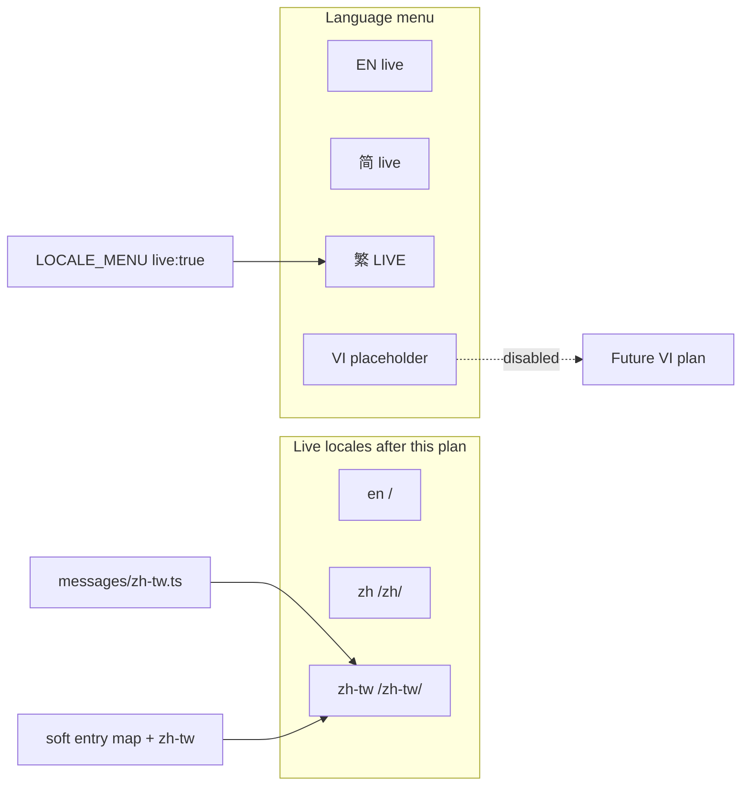

# Marketing Site Traditional Chinese Locale (zh-tw) - Plan

## Goal Capsule

- **Objective:** Ship **Traditional Chinese (繁體中文)** as a fully live marketing locale for the landing home and forecast pages so TW/HK-style readers can self-serve the Color Brain story and request a pilot without English or Simplified Chinese.
- **Product authority:** Marketing package only (`landing/`). Product app (`app/`) is out of scope. Vietnamese stays a disabled menu placeholder.
- **Open blockers:** None.
- **Execution profile:** Extend the existing multi-locale i18n rails; flip `zh-tw` from menu placeholder to live; verify with `cd landing && npm run build` plus route/menu smoke.
- **Stop conditions:** Stop if asked to implement Vietnamese, product-app i18n, or browser auto-detect in this workstream.

---

## Product Contract

### Summary

Enable **Traditional Chinese** on the public marketing site (home + forecast + shared chrome) using the same locale-URL and language-menu patterns as Simplified Chinese.
English remains the default first-visit language; soft entry continues to honor an explicit preference cookie only on bare `/`.
Vietnamese remains listed but disabled until a later plan.

### Problem Frame

The marketing site already supports English and Simplified Chinese with a multi-locale language control that lists **繁體中文** and **Tiếng Việt** as non-clickable placeholders.
Prospects who prefer Traditional Chinese still cannot complete the marketing story or forecast in 繁體; sales and pilots absorb that gap offline.
The product app remains English-only and is not part of this work.

### Key Decisions

- **Marketing only** — do not localize `app/`. (session-settled: user-directed — chosen over including the product app) Governs R1.
- **Traditional Chinese only this plan** — Vietnamese stays placeholder. (session-settled: user-directed — chosen over implementing VI now) Governs R2, R12.
- **Full marketing parity with existing live locales** — home + forecast + chrome + SEO + forecast client strings, not a partial pack. (session-settled: user-approved — chosen over homepage-only) Governs R3–R11.
- **Reuse existing i18n architecture** — flip `zh-tw` live rather than invent a second system. Governs R4–R6, KTD1–KTD4.
- **URL segment `zh-tw`** with `html lang` / `hreflang` / `Intl` as `zh-TW`. (session-settled: user-approved — chosen over renaming the placeholder id) Governs R4, R8, KTD1.
- **Copy pipeline: convert from 简体 then review** — OpenCC (or equivalent) s2tw from `zh.ts`, then human pass for dye/mill tone. Governs R10, KTD5.
- **Inherit bilingual product rules** from the EN+简体 work: URL wins over preference on deep links; soft entry bare `/` only; forecast language switch resets wizard; app link stays English with no interstitial. Governs R7–R9, R11.

<!-- ce-section: work-relationships -->
### How This Work Fits Together

- **This plan — Traditional Chinese marketing locale** — makes `zh-tw` live on `landing/`.
  - **Depends on** existing EN + 简体 i18n rails (`LOCALES`, catalogs, Nav menu, soft entry, SEO helpers).
  - **Can proceed independently of** product-app localization and Vietnamese.
- **Prior plan** — `docs/plans/2026-08-08-001-feat-marketing-bilingual-locale-plan.md` (EN + 简体) established the rails this plan extends.
- **Vietnamese marketing locale** (later)
  - **Can proceed independently** once this pattern is proven; remains `live: false` here.

### Actors

- A1. **Traditional Chinese-preferring prospect** — reads marketing in 繁體, runs forecast, requests pilot.
- A2. **Existing EN / 简体 visitors** — must not regress.
- A3. **Sales / GTM** — may share `/zh-tw/` URLs.

### Key Flows

- F1. Choose 繁體 from language menu
  - **Trigger:** Visitor opens language control and selects 繁體中文.
  - **Steps:** Navigate to counterpart path under `/zh-tw/`; preference cookie set to `zh-tw`; menu shows 繁 as current.
  - **Outcome:** Full marketing UI in Traditional Chinese.
  - **Covered by:** R3, R5, R6

- F2. Soft entry remembers 繁體
  - **Trigger:** Returning visitor with cookie `zh-tw` opens bare `/` (empty hash).
  - **Steps:** Soft-entry script redirects to `/zh-tw/`.
  - **Outcome:** No re-pick required.
  - **Covered by:** R7

- F3. Deep English URL still wins
  - **Trigger:** Cookie `zh-tw` + open `/forecast`.
  - **Steps:** Page stays English; no force-redirect to 繁體.
  - **Outcome:** Shareable English deep links remain reliable.
  - **Covered by:** R7

- F4. Forecast self-serve in 繁體
  - **Trigger:** Visitor on `/zh-tw/forecast` completes wizard.
  - **Steps:** Static chrome + client wizard strings/templates/numbers use Traditional Chinese; language switch to another locale resets wizard.
  - **Outcome:** Full forecast path usable without English/简体.
  - **Covered by:** R3, R9, R11

- F5. App handoff unchanged
  - **Trigger:** Open the App from 繁體 marketing.
  - **Steps:** Link to existing English app; no interstitial.
  - **Covered by:** R11

### Requirements

**Scope**

- R1. Work is limited to the public marketing site (`landing/` home, forecast, shared chrome). Product app is out of scope.
- R2. New live locale is Traditional Chinese only. Vietnamese remains a disabled menu placeholder.
- R3. Every marketing surface available in English/简体 (home sections, forecast wizard + results, nav, footer, CTAs, a11y strings) is available in 繁體 with equivalent meaning.

**Locale identity**

- R4. Traditional Chinese uses URL segment `zh-tw` (`/zh-tw/`, `/zh-tw/forecast`). Document language and number formatting use `zh-TW`.
- R5. Language menu entry for 繁體中文 is enabled (no longer `live: false` / “Coming soon”).
- R6. Switching language lands on the counterpart page/section for the target locale when a counterpart exists; unmatched hash falls back to locale home.
- R7. Soft entry and preference rules match existing marketing i18n: explicit locale content URLs always win; remembered preference applies only on bare `/` with empty hash; default first visit remains English without browser/geo auto-detect.
- R8. SEO for 繁體 pages: localized title/description/OG (parity with other locales), self-canonical, `hreflang` includes `zh-TW` paired with EN/简体 counterparts and existing `x-default` → English; sitemap coverage includes 繁體 routes when a sitemap exists.

**Quality and handoffs**

- R9. Forecast client strings (including composed templates) and number formatting follow page locale for `zh-tw`. Language switch mid-forecast navigates to counterpart forecast URL and resets wizard to step 1.
- R10. Traditional Chinese copy is natural 繁體 suitable for professional textile/dyeing buyers — conversion from 简体 is allowed as a draft step; primary surfaces must not ship broken machine-only output.
- R11. Open the App continues to the English product app with no required interstitial from 繁體 pages.
- R12. Vietnamese menu placeholder remains disabled and is not implemented in this plan.

### Acceptance Examples

- AE1. Menu enables 繁體
  - **Covers R5.**
  - **Given:** Visitor on English or 简体 marketing.
  - **When:** They open the language menu.
  - **Then:** 繁體中文 is selectable (not “Coming soon”); selecting it navigates to a `/zh-tw/…` counterpart and sets preference.

- AE2. Full 繁體 self-serve
  - **Covers R3, R9, R11.**
  - **Given:** Visitor on `/zh-tw/`.
  - **When:** They read home sections, open `/zh-tw/forecast`, complete enough of the wizard to see results, and reach pilot CTA.
  - **Then:** Visible marketing UI for that path is Traditional Chinese; pilot CTA usable; Open the App still goes to the English app.

- AE3. Soft entry
  - **Covers R7.**
  - **Given:** Cookie preference is `zh-tw`.
  - **When:** They open bare `/` with empty hash.
  - **Then:** They land on `/zh-tw/` without re-selecting language.

- AE4. Deep link wins
  - **Covers R7.**
  - **Given:** Cookie preference is `zh-tw`.
  - **When:** They open `/forecast`.
  - **Then:** Page is English; they are not redirected to 繁體 solely due to cookie.

- AE5. EN / 简体 regression
  - **Covers R2, R12.**
  - **Given:** Existing English and Simplified Chinese routes.
  - **When:** Build and smoke after the change.
  - **Then:** EN and 简体 still work; Vietnamese remains a disabled placeholder.

### Success Criteria

- A Traditional Chinese-preferring prospect can complete the marketing story and pilot request on home + forecast without English or 简体.
- Language menu treats 繁 as a first-class live locale.
- EN and 简体 do not regress; Vietnamese stays placeholder.
- `cd landing && npm run build` passes.

### Scope Boundaries

**In scope**

- Flip `zh-tw` to live: locale constants, Astro i18n locales list, message catalog, pages, soft-entry map, SEO/hreflang, Nav menu enablement.
- Full home + forecast + chrome + forecast client strings for 繁體.
- Copy conversion + quality review for primary surfaces.

**Deferred for later**

- Vietnamese (`vi`) implementation.
- Product app localization.
- Browser/geo auto-detect.
- Native professional review staffing process beyond the quality bar in R10.

**Out of scope**

- Changing EN/简体 product behavior except as required to register the new locale generically.
- Reworking the language control visual design beyond enabling the 繁 entry.

### Dependencies / Assumptions

- **Assumption:** Existing EN + 简体 i18n rails remain the pattern (`landing/src/i18n/*`, `MarketingHome` / `ForecastPage`, Nav dropdown + `LOCALE_MENU`).
- **Assumption:** Placeholder id `zh-tw` in `LOCALE_MENU` is the URL segment to activate (confirmed in scoping).
- **Dependency:** Draft 繁體 may come from converting `messages/zh.ts`; ship-quality still requires a pass against R10.
- **Non-dependency:** Product app i18n is not required.

### Outstanding Questions

**Resolve Before Planning**

- (none)

**Deferred to Implementation**

- Exact conversion tool (OpenCC s2tw vs manual edit) if OpenCC is inconvenient in the environment — any method that yields key-parity `Messages` is fine.
- Whether sitemap is generated or static — extend whichever mechanism already exists after EN+简体 work.
- Native reviewer identity for R10 sign-off.

### Sources / Research

- Live locale placeholder design: `landing/src/i18n/locales.ts` (`LOCALE_MENU` with `zh-tw` / `vi` `live: false`).
- Live catalogs today: `landing/src/i18n/messages/en.ts`, `zh.ts`; index only registers live locales.
- Pages: `landing/src/pages/index.astro`, `forecast.astro`, `zh/*` shells.
- Prior EN+简体 plan: `docs/plans/2026-08-08-001-feat-marketing-bilingual-locale-plan.md`.
- Astro i18n: add `"zh-tw"` to `astro.config.mjs` `i18n.locales` with `prefixDefaultLocale: false`.

---

## Planning Contract

### Key Technical Decisions

- KTD1. **Activate id `zh-tw` as live Locale** — Extend `LOCALES` to `["en", "zh", "zh-tw"]`; set `LOCALE_MENU` entry `zh-tw.live = true`; map `LOCALE_HTML_LANG` / `LOCALE_HREFLANG` / `LOCALE_INTL` / `LOCALE_LABELS` for `zh-tw` (`繁`, `繁體中文`, `zh-TW`). Aligns with R4, R5.

- KTD2. **Astro i18n list includes `zh-tw`** — `astro.config.mjs` `i18n.locales: ["en", "zh", "zh-tw"]` so `getRelativeLocaleUrl` and static routes resolve `/zh-tw/` and `/zh-tw/forecast`. Aligns with R4.

- KTD3. **Thin page shells** — `landing/src/pages/zh-tw/index.astro` and `forecast.astro` mirror `zh/*` and pass `locale="zh-tw"` into `MarketingHome` / `ForecastPage`. Aligns with R3.

- KTD4. **Typed catalog `zhTw` satisfies `Messages`** — New `landing/src/i18n/messages/zh-tw.ts` registered in `messages/index.ts`. Prefer generating from `zh.ts` via OpenCC `s2tw` (or equivalent), then hand-edit dye/mill phrasing. Typecheck enforces key parity. Aligns with R3, R10.

- KTD5. **Wire soft entry + SEO generically for live locales** — Soft-entry inline map must include `zh-tw: "/zh-tw/"` (and only live non-default locales). `hreflangLinks` already iterates `LOCALES` — verify it picks up `zh-tw` without hardcoding. Aligns with R7, R8.

- KTD6. **Vietnamese remains placeholder** — Do not add `vi` to `LOCALES`, Astro locales, catalogs, or soft-entry map. Keep `LOCALE_MENU` entry `live: false`. Aligns with R2, R12.

- KTD7. **No browser-language auto switch** — Do not enable Accept-Language routing when registering the new locale. Aligns with R7.

### High-Level Technical Design

**Activation checklist (mechanism):**

1. Catalog + types register `zh-tw`.
2. Astro + `LOCALES` + labels/lang maps.
3. Pages under `src/pages/zh-tw/`.
4. Soft-entry map + cookie accept `zh-tw`.
5. Menu `live: true`.
6. SEO/hreflang/sitemap include `zh-TW` URLs.

### Assumptions

- `MarketingHome` / `ForecastPage` / Nav already accept any `Locale` from `LOCALES` once the type expands.
- Forecast wizard already takes locale + messages; adding a catalog is sufficient for R9 if EN/简 already inject messages correctly.
- Soft-entry script may still contain stale keys from earlier experiments — implementers must set the map to **live locales only** (`zh`, `zh-tw`) after this plan.

### Implementation Constraints

- Do not modify `app/`.
- Do not implement Vietnamese content or routes.
- Do not enable browser auto-detect.
- Preserve EN and 简体 behavior and URL stability.

### Sequencing

U1 locale foundation → U2 catalog → U3 pages + menu live → U4 soft entry / SEO / sitemap → U5 copy QA + acceptance.

---

## Implementation Units

### U1. Register `zh-tw` as a live locale

- **Goal:** Type system, Astro config, and locale maps know Traditional Chinese as live.
- **Requirements:** R2, R4, R5 (config side), R12, KTD1, KTD2, KTD6, KTD7
- **Dependencies:** none
- **Files:**
  - Modify: `landing/src/i18n/locales.ts`
  - Modify: `landing/astro.config.mjs`
- **Approach:**
  1. Add `"zh-tw"` to `LOCALES` and all `Record<Locale, …>` maps (labels `繁`, native `繁體中文`, html/hreflang/intl `zh-TW`).
  2. Set `LOCALE_MENU` entry for `zh-tw` to `live: true` (can land in U3 if preferred — either unit owns the flip, not both inconsistently; **this unit owns the flip**).
  3. Add `"zh-tw"` to Astro `i18n.locales`.
  4. Leave `vi` as `live: false` only in the menu; not in `LOCALES`.
- **Test scenarios:**
  - `isLocale("zh-tw")` is true; `isLocale("vi")` is false.
  - Typecheck fails if a `Record<Locale, …>` omits `zh-tw`.
  - Astro config lists three locales; no Accept-Language routing enabled.
- **Verification:** Project typechecks against expanded `Locale` (may fail until U2 registers catalog — complete U1+U2 before requiring clean build).

### U2. Traditional Chinese message catalog

- **Goal:** Full `Messages` catalog for 繁體 with key parity to EN/简体.
- **Requirements:** R3, R9 (string coverage), R10, KTD4
- **Dependencies:** U1
- **Files:**
  - Create: `landing/src/i18n/messages/zh-tw.ts` (`export const zhTw`)
  - Modify: `landing/src/i18n/messages/index.ts` (register `"zh-tw": zhTw`)
- **Approach:**
  1. Seed from `zh.ts` via OpenCC `s2tw` (or equivalent) converting string literals only.
  2. Hand-fix brand-adjacent and dye/mill phrases for Taiwan-style 繁體 where conversion is awkward.
  3. Ensure forecast templates and a11y strings are present (same keys as `en`/`zh`).
  4. Keep brand “Color Brain” and technical tokens Latin where EN/简 already do.
- **Execution note:** Prefer typecheck key parity over perfect literary polish in this unit; U5 owns R10 ship bar.
- **Test scenarios:**
  - `zhTw satisfies Messages` / catalog typechecks.
  - Missing key vs `en` fails typecheck.
  - Spot-check: hero, pilot CTA, forecast step labels exist and are 繁體 (not leftover 简体-only where conversion should have run).
- **Verification:** `astro check` accepts the new catalog registration.

### U3. Pages and language menu enablement

- **Goal:** Routable 繁體 home/forecast; menu switches to them.
- **Requirements:** R3, R5, R6, R11, KTD3
- **Dependencies:** U1, U2
- **Files:**
  - Create: `landing/src/pages/zh-tw/index.astro`
  - Create: `landing/src/pages/zh-tw/forecast.astro`
  - Modify if needed: `landing/src/components/Nav.astro` (should already render live menu entries — verify placeholder branch no longer applies to `zh-tw`)
  - Modify if needed: `MarketingHome.astro` / `ForecastPage.astro` only if they hardcode locale unions
- **Approach:**
  1. Mirror `zh/index.astro` and `zh/forecast.astro` shells with `locale="zh-tw"`.
  2. Confirm Nav lists 繁 as active/switchable links (not `is-placeholder`).
  3. Confirm internal path helpers produce `/zh-tw/` and `/zh-tw/forecast`.
  4. App URL remains absolute English app.
- **Test scenarios:**
  - Covers AE1. Menu selects 繁體 → `/zh-tw/` or forecast counterpart.
  - Covers AE2 (static). `/zh-tw/` and `/zh-tw/forecast` render 繁體 chrome.
  - Covers AE5 partial. EN and `/zh/` still resolve.
  - Pilot / app links on 繁體 pages behave per R11.
- **Verification:** `npm run build` emits six marketing HTML routes (EN home/forecast, zh home/forecast, zh-tw home/forecast).

### U4. Soft entry, SEO, sitemap

- **Goal:** Preference + discovery surfaces treat 繁體 as a first-class live locale.
- **Requirements:** R7, R8, KTD5
- **Dependencies:** U1, U3
- **Files:**
  - Modify: `landing/src/i18n/preference.ts` (soft-entry inline map — live locales only: `zh`, `zh-tw`)
  - Modify if needed: `landing/src/i18n/seo.ts` (should already iterate `LOCALES`)
  - Modify: sitemap integration or `public/sitemap.xml` if present
- **Approach:**
  1. Soft-entry map: `{ zh: "/zh/", "zh-tw": "/zh-tw/" }` — remove any stale `vi` redirect if present.
  2. Verify hreflang output on EN/简/繁 pages includes `zh-TW` alternates + `x-default` English.
  3. Extend sitemap to list `/zh-tw/` and `/zh-tw/forecast` (trailing-slash style consistent with build).
- **Test scenarios:**
  - Covers AE3. Cookie `zh-tw` + bare `/` → `/zh-tw/`.
  - Covers AE4. Cookie `zh-tw` + `/forecast` stays English.
  - View-source: 繁體 pages have `lang` appropriate for Traditional Chinese and reciprocal hreflang.
  - Soft entry does **not** redirect for `vi` cookie values (invalid / ignored).
- **Verification:** Manual cookie + view-source checks on preview build.

### U5. Copy QA and full acceptance

- **Goal:** Ship-quality 繁體 on primary surfaces; full AE walkthrough.
- **Requirements:** R10, R3, R9, Success Criteria, AE2, AE5
- **Dependencies:** U1–U4
- **Files:**
  - Modify: `landing/src/i18n/messages/zh-tw.ts` (polish)
  - Modify: `landing/README.md` (document `/zh-tw/` locale briefly)
- **Approach:**
  1. Review hero, problem, how-it-works, proof, contact, forecast hero/results for natural 繁體.
  2. Walk forecast wizard end-to-end on `/zh-tw/forecast`.
  3. Confirm language switch mid-wizard resets (existing behavior).
  4. Regression smoke EN + 简; Vietnamese still disabled in menu.
- **Test scenarios:**
  - Covers AE2 full path including wizard results framing in 繁體.
  - Covers AE5. Vietnamese still shows coming-soon / disabled.
  - No obvious 简体/English mix on primary CTAs for 繁體 pages.
- **Verification:** Preview AE checklist complete; `npm run build` green.

---

## Verification Contract

| Gate | Command / action | Proves |
| --- | --- | --- |
| Typecheck + build | `cd landing && npm run build` | Catalog + routes compile; 6 HTML pages |
| Preview routes | Open `/`, `/zh/`, `/zh-tw/`, `/forecast`, `/zh/forecast`, `/zh-tw/forecast` | R3, R4 |
| Menu | Enable 繁; disabled VI | R5, R12, AE1, AE5 |
| Soft entry / URL wins | Cookie scenarios on `/` vs `/forecast` | R7, AE3, AE4 |
| Forecast 繁體 | Complete wizard on `/zh-tw/forecast` | R9, AE2 |
| SEO spot-check | View-source hreflang/canonical on 繁體 pages | R8 |

---

## Definition of Done

- U1–U5 complete with verification outcomes.
- R1–R12 satisfied.
- AE1–AE5 demonstrable on preview.
- `cd landing && npm run build` passes.
- Vietnamese still placeholder; `app/` untouched.
- Abandoned experiment code (e.g. half-enabled `vi` redirects) removed from soft-entry map.
- README notes `/zh-tw/` as a live marketing locale.

---

## System-Wide Impact

- **SEO:** New `/zh-tw/` URLs and `hreflang="zh-TW"`; EN remains `x-default`.
- **Analytics:** Path metrics gain a third language split for marketing.
- **App domain:** Unchanged English handoff.
- **Future VI:** Same activation checklist; not started here.

---

## Risks & Dependencies

| Risk | Mitigation |
| --- | --- |
| OpenCC-quality 繁體 feels mainland-converted | U5 human polish on primary surfaces (R10) |
| Soft-entry map drifts (stale `vi` keys) | U4 explicitly sets live-only map; add checklist in DoD |
| Hardcoded locale unions in components | Grep for `"zh"`-only unions during U1/U3 |
| Sitemap forgets new routes | U4 ownership + build listing check |

---

## Alternative Approaches Considered

- **Homepage-only 繁體** — Rejected; user confirmed full marketing parity.
- **Rename URL to `zh-hant` / `tw`** — Rejected; keep existing menu id `zh-tw`.
- **Implement Vietnamese in the same PR** — Rejected; user scoped Traditional Chinese only.
- **Serve 繁體 via client-only string swap on 简体 URLs** — Rejected; breaks shareable locale URLs and contradicts existing architecture.

---

## Sources & Research (planning)

- `landing/src/i18n/locales.ts` — `LOCALE_MENU` placeholder pattern for `zh-tw` / `vi`.
- `landing/src/i18n/messages/{en,zh}.ts` — catalog shape to extend.
- `landing/src/pages/zh/*` — shell pattern for `zh-tw/*`.
- `docs/plans/2026-08-08-001-feat-marketing-bilingual-locale-plan.md` — product rules inherited (URL wins, soft entry, forecast reset).
- Astro i18n routing with `prefixDefaultLocale: false`.
