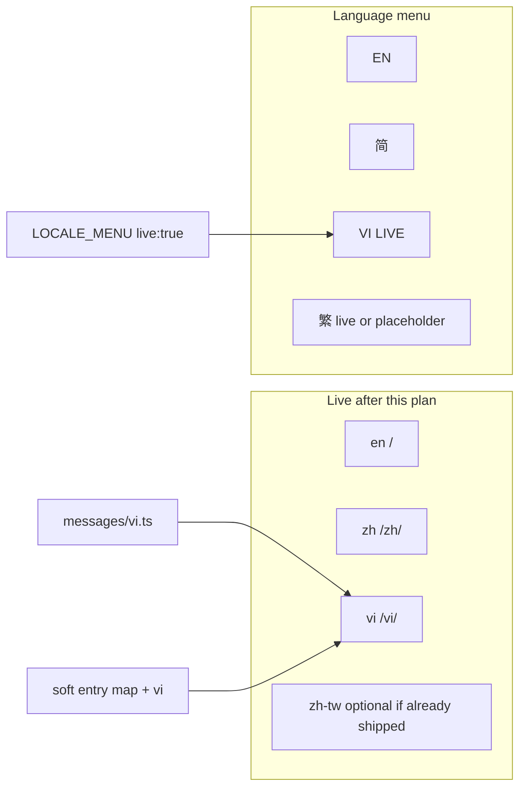

# Marketing Site Vietnamese Locale (vi) - Plan

## Goal Capsule

- **Objective:** Ship **Vietnamese (Tiếng Việt)** as a fully live marketing locale for the landing home and forecast pages so Vietnamese-speaking prospects can self-serve the Color Brain story and request a pilot without English or Chinese.
- **Product authority:** Marketing package only (`landing/`). Product app (`app/`) is out of scope.
- **Open blockers:** None.
- **Execution profile:** Extend the existing multi-locale i18n rails; flip `vi` from menu placeholder to live; verify with `cd landing && npm run build` plus route/menu smoke.
- **Stop conditions:** Stop if asked to implement product-app i18n or browser auto-detect in this workstream.

---

## Product Contract

### Summary

Enable **Vietnamese** on the public marketing site (home + forecast + shared chrome) using the same locale-URL and language-menu patterns as English and Simplified Chinese (and Traditional Chinese when live).
English remains the default first-visit language; soft entry continues to honor an explicit preference cookie only on bare `/`.

### Problem Frame

The marketing language menu already lists **Tiếng Việt** as a non-clickable placeholder (`LOCALE_MENU` entry `vi`, `live: false`).
Vietnamese-speaking prospects cannot complete the marketing story or forecast in their language; sales and pilots absorb that gap offline.
The product app remains English-only and is not part of this work.

### Key Decisions

- **Marketing only** — do not localize `app/`. (session-settled: user-directed — chosen over including the product app; same posture as EN/简 and zh-tw plans) Governs R1.
- **Vietnamese only this plan** — do not bundle unrelated locales or app work. (session-settled: user-directed) Governs R2.
- **Full marketing parity with existing live locales** — home + forecast + chrome + SEO + forecast client strings, not a partial pack. (session-settled: user-approved — same bar as zh-tw plan) Governs R3–R11.
- **Reuse existing i18n architecture** — flip `vi` live rather than invent a second system. Governs R4–R6, KTD1–KTD4.
- **URL segment `vi`** with `html lang` / `hreflang` / `Intl` as `vi` / `vi-VN`. (session-settled: user-approved — matches existing menu placeholder id) Governs R4, R8, KTD1.
- **Copy pipeline: human-quality Vietnamese catalog** — may draft with AI assistance from English source of truth; primary surfaces must read as natural professional Vietnamese (dye/mill tone). Governs R10, KTD4.
- **Inherit marketing i18n product rules:** URL wins over preference on deep links; soft entry bare `/` only; forecast language switch resets wizard; app link stays English with no interstitial. Governs R7–R9, R11.

<!-- ce-section: work-relationships -->
### How This Work Fits Together

- **This plan — Vietnamese marketing locale** — makes `vi` live on `landing/`.
  - **Depends on** existing multi-locale i18n rails (`LOCALES`, catalogs, Nav menu, soft entry, SEO helpers).
  - **Can proceed independently of** Traditional Chinese (`zh-tw`) activation and product-app localization.
- **Prior plans**
  - `docs/plans/2026-08-08-001-feat-marketing-bilingual-locale-plan.md` — EN + 简体 rails.
  - `docs/plans/2026-08-08-002-feat-marketing-zh-tw-locale-plan.md` — same activation checklist for `zh-tw` (sibling pattern).
- **Product app localization** (later) — not required for this plan.

### Actors

- A1. **Vietnamese-speaking prospect** — reads marketing in Tiếng Việt, runs forecast, requests pilot.
- A2. **Existing EN / 简体 / (optional 繁體) visitors** — must not regress.
- A3. **Sales / GTM** — may share `/vi/` URLs.

### Key Flows

- F1. Choose Vietnamese from language menu
  - **Trigger:** Visitor opens language control and selects Tiếng Việt.
  - **Steps:** Navigate to counterpart path under `/vi/`; preference cookie set to `vi`; menu shows VI as current.
  - **Outcome:** Full marketing UI in Vietnamese.
  - **Covered by:** R3, R5, R6

- F2. Soft entry remembers Vietnamese
  - **Trigger:** Returning visitor with cookie `vi` opens bare `/` (empty hash).
  - **Steps:** Soft-entry script redirects to `/vi/`.
  - **Outcome:** No re-pick required.
  - **Covered by:** R7

- F3. Deep English URL still wins
  - **Trigger:** Cookie `vi` + open `/forecast`.
  - **Steps:** Page stays English; no force-redirect to Vietnamese.
  - **Outcome:** Shareable English deep links remain reliable.
  - **Covered by:** R7

- F4. Forecast self-serve in Vietnamese
  - **Trigger:** Visitor on `/vi/forecast` completes wizard.
  - **Steps:** Static chrome + client wizard strings/templates/numbers use Vietnamese; language switch to another locale resets wizard.
  - **Outcome:** Full forecast path usable without English.
  - **Covered by:** R3, R9, R11

- F5. App handoff unchanged
  - **Trigger:** Open the App from Vietnamese marketing.
  - **Steps:** Link to existing English app; no interstitial.
  - **Covered by:** R11

### Requirements

**Scope**

- R1. Work is limited to the public marketing site (`landing/` home, forecast, shared chrome). Product app is out of scope.
- R2. New live locale is Vietnamese only (no unrelated feature bundling).
- R3. Every marketing surface available in other live locales (home sections, forecast wizard + results, nav, footer, CTAs, a11y strings) is available in Vietnamese with equivalent meaning.

**Locale identity**

- R4. Vietnamese uses URL segment `vi` (`/vi/`, `/vi/forecast`). Document language uses `vi`; number formatting uses `vi-VN` (or equivalent Vietnamese Intl tag).
- R5. Language menu entry for Tiếng Việt is enabled (no longer `live: false` / “Coming soon”).
- R6. Switching language lands on the counterpart page/section for the target locale when a counterpart exists; unmatched hash falls back to locale home.
- R7. Soft entry and preference rules match existing marketing i18n: explicit locale content URLs always win; remembered preference applies only on bare `/` with empty hash; default first visit remains English without browser/geo auto-detect.
- R8. SEO for Vietnamese pages: localized title/description/OG (parity with other locales), self-canonical, `hreflang` includes `vi` paired with other live locale counterparts and existing `x-default` → English; sitemap coverage includes Vietnamese routes when a sitemap exists.

**Quality and handoffs**

- R9. Forecast client strings (including composed templates) and number formatting follow page locale for `vi`. Language switch mid-forecast navigates to the counterpart forecast URL and resets wizard to step 1.
- R10. Vietnamese copy is natural Tiếng Việt suitable for professional textile/dyeing buyers — AI-assisted draft is allowed; primary surfaces must not ship broken machine-only output.
- R11. Open the App continues to the English product app with no required interstitial from Vietnamese pages.

### Acceptance Examples

- AE1. Menu enables Vietnamese
  - **Covers R5.**
  - **Given:** Visitor on any live marketing locale.
  - **When:** They open the language menu.
  - **Then:** Tiếng Việt is selectable (not “Coming soon”); selecting it navigates to a `/vi/…` counterpart and sets preference.

- AE2. Full Vietnamese self-serve
  - **Covers R3, R9, R11.**
  - **Given:** Visitor on `/vi/`.
  - **When:** They read home sections, open `/vi/forecast`, complete enough of the wizard to see results, and reach pilot CTA.
  - **Then:** Visible marketing UI for that path is Vietnamese; pilot CTA usable; Open the App still goes to the English app.

- AE3. Soft entry
  - **Covers R7.**
  - **Given:** Cookie preference is `vi`.
  - **When:** They open bare `/` with empty hash.
  - **Then:** They land on `/vi/` without re-selecting language.

- AE4. Deep link wins
  - **Covers R7.**
  - **Given:** Cookie preference is `vi`.
  - **When:** They open `/forecast`.
  - **Then:** Page is English; they are not redirected to Vietnamese solely due to cookie.

- AE5. Other locales regression
  - **Covers R2.**
  - **Given:** Existing live locales (at minimum EN and 简体; 繁體 if already shipped).
  - **When:** Build and smoke after the change.
  - **Then:** Those locales still work; Vietnamese routes are live and complete.

### Success Criteria

- A Vietnamese-speaking prospect can complete the marketing story and pilot request on home + forecast without English.
- Language menu treats VI as a first-class live locale.
- Other live locales do not regress.
- `cd landing && npm run build` passes.

### Scope Boundaries

**In scope**

- Flip `vi` to live: locale constants, Astro i18n locales list, message catalog, pages, soft-entry map, SEO/hreflang, Nav menu enablement.
- Full home + forecast + chrome + forecast client strings for Vietnamese.
- Copy draft + quality review for primary surfaces.

**Deferred for later**

- Product app localization.
- Browser/geo auto-detect.
- Native reviewer staffing process beyond the quality bar in R10.

**Out of scope**

- Changing other locales’ product behavior except as required to register the new locale generically.
- Redesigning the language control visual design beyond enabling the VI entry.

### Dependencies / Assumptions

- **Assumption:** Existing multi-locale i18n rails remain the pattern (`landing/src/i18n/*`, `MarketingHome` / `ForecastPage`, Nav dropdown + `LOCALE_MENU`).
- **Assumption:** Placeholder id `vi` in `LOCALE_MENU` is the URL segment to activate.
- **Assumption:** If Traditional Chinese is not yet live when this ships, soft-entry and `LOCALES` still only include truly live locales (do not leave dead redirect keys).
- **Dependency:** Vietnamese catalog needs a quality pass against R10 before treating primary surfaces as ship-ready.
- **Non-dependency:** Product app i18n is not required. Completing `zh-tw` first is optional — this plan can run in parallel.

### Outstanding Questions

**Resolve Before Planning**

- (none)

**Deferred to Implementation**

- Whether to draft from English only or also compare 简体 structure for key order — English is source of meaning; structure must match `Messages` type.
- Sitemap mechanism already in use after prior locale work — extend it, do not invent a second one.
- Native reviewer identity for R10 sign-off.

### Sources / Research

- Live locale placeholder design: `landing/src/i18n/locales.ts` (`LOCALE_MENU` with `vi` `live: false`).
- Live catalogs today: `landing/src/i18n/messages/en.ts`, `zh.ts` (+ `zh-tw.ts` if already merged).
- Page shell pattern: `landing/src/pages/zh/*` (and `zh-tw/*` if present).
- Sibling activation plan: `docs/plans/2026-08-08-002-feat-marketing-zh-tw-locale-plan.md`.
- Prior EN+简体 plan: `docs/plans/2026-08-08-001-feat-marketing-bilingual-locale-plan.md`.
- Astro i18n: add `"vi"` to `astro.config.mjs` `i18n.locales` with `prefixDefaultLocale: false`.

---

## Planning Contract

### Key Technical Decisions

- KTD1. **Activate id `vi` as live Locale** — Extend `LOCALES` to include `"vi"`; set `LOCALE_MENU` entry `vi.live = true`; map labels `VI` / `Tiếng Việt`, `LOCALE_HTML_LANG`/`HREFLANG` `vi`, `LOCALE_INTL` `vi-VN`. Aligns with R4, R5.

- KTD2. **Astro i18n list includes `vi`** — Add `"vi"` to `astro.config.mjs` `i18n.locales` so static routes resolve `/vi/` and `/vi/forecast`. Aligns with R4.

- KTD3. **Thin page shells** — `landing/src/pages/vi/index.astro` and `forecast.astro` mirror `zh/*` and pass `locale="vi"` into `MarketingHome` / `ForecastPage`. Aligns with R3.

- KTD4. **Typed catalog `vi` satisfies `Messages`** — New `landing/src/i18n/messages/vi.ts` registered in `messages/index.ts`. Draft from English meaning; enforce key parity via typecheck; polish textile/dye phrasing for R10. Keep brand “Color Brain” and technical tokens Latin where other locales do. Aligns with R3, R10.

- KTD5. **Wire soft entry + SEO for live locales only** — Soft-entry inline map must include `vi: "/vi/"` and every other **currently live** non-default locale (e.g. `zh`, and `zh-tw` if already live). Remove stale keys for locales that are not live. `hreflangLinks` should iterate `LOCALES` generically. Aligns with R7, R8.

- KTD6. **No browser-language auto switch** — Do not enable Accept-Language routing when registering the new locale. Aligns with R7.

### High-Level Technical Design

**Activation checklist (same pattern as zh-tw):**

1. Catalog + types register `vi`.
2. Astro + `LOCALES` + labels/lang maps.
3. Pages under `src/pages/vi/`.
4. Soft-entry map + cookie accept `vi`.
5. Menu `live: true`.
6. SEO/hreflang/sitemap include `vi` URLs.

### Assumptions

- `MarketingHome` / `ForecastPage` / Nav already accept any `Locale` from `LOCALES` once the type expands.
- Forecast wizard already takes locale + messages; adding a catalog is sufficient for R9 if other locales already inject messages correctly.

### Implementation Constraints

- Do not modify `app/`.
- Do not enable browser auto-detect.
- Preserve EN and other live locales’ behavior and URL stability.
- Soft-entry map must only list live locales (no dangling placeholders).

### Sequencing

U1 locale foundation → U2 catalog → U3 pages + menu live → U4 soft entry / SEO / sitemap → U5 copy QA + acceptance.

---

## Implementation Units

### U1. Register `vi` as a live locale

- **Goal:** Type system, Astro config, and locale maps know Vietnamese as live.
- **Requirements:** R2, R4, R5 (config side), KTD1, KTD2, KTD6
- **Dependencies:** none
- **Files:**
  - Modify: `landing/src/i18n/locales.ts`
  - Modify: `landing/astro.config.mjs`
- **Approach:**
  1. Add `"vi"` to `LOCALES` and all `Record<Locale, …>` maps.
  2. Set `LOCALE_MENU` entry for `vi` to `live: true` (**this unit owns the flip**).
  3. Add `"vi"` to Astro `i18n.locales`.
- **Test scenarios:**
  - `isLocale("vi")` is true.
  - Typecheck fails if a `Record<Locale, …>` omits `vi`.
  - Astro config includes `vi`; no Accept-Language routing enabled.
- **Verification:** Types expand cleanly once U2 registers the catalog (complete U1+U2 before requiring clean build).

### U2. Vietnamese message catalog

- **Goal:** Full `Messages` catalog for Tiếng Việt with key parity to EN (and other live catalogs).
- **Requirements:** R3, R9 (string coverage), R10, KTD4
- **Dependencies:** U1
- **Files:**
  - Create: `landing/src/i18n/messages/vi.ts` (`export const vi`)
  - Modify: `landing/src/i18n/messages/index.ts` (register `vi`)
- **Approach:**
  1. Author/complete Vietnamese strings for every key in `Messages` (English is meaning source).
  2. Include forecast templates and a11y strings.
  3. Keep brand and technical tokens consistent with other locales.
- **Execution note:** Prefer typecheck key parity first; U5 owns ship-quality polish.
- **Test scenarios:**
  - Catalog typechecks / satisfies `Messages`.
  - Missing key vs `en` fails typecheck.
  - Spot-check: hero, pilot CTA, forecast step labels are Vietnamese.
- **Verification:** `astro check` accepts the new catalog registration.

### U3. Pages and language menu enablement

- **Goal:** Routable Vietnamese home/forecast; menu switches to them.
- **Requirements:** R3, R5, R6, R11, KTD3
- **Dependencies:** U1, U2
- **Files:**
  - Create: `landing/src/pages/vi/index.astro`
  - Create: `landing/src/pages/vi/forecast.astro`
  - Modify if needed: Nav / page components only if they hardcode locale unions
- **Approach:**
  1. Mirror existing non-default locale shells with `locale="vi"`.
  2. Confirm Nav lists VI as active/switchable (not `is-placeholder`).
  3. Confirm path helpers produce `/vi/` and `/vi/forecast`.
  4. App URL remains absolute English app.
- **Test scenarios:**
  - Covers AE1. Menu selects Vietnamese → `/vi/` or forecast counterpart.
  - Covers AE2 (static). `/vi/` and `/vi/forecast` render Vietnamese chrome.
  - Covers AE5 partial. EN and other live locales still resolve.
  - Pilot / app links on Vietnamese pages behave per R11.
- **Verification:** `npm run build` emits Vietnamese HTML routes alongside other live locales.

### U4. Soft entry, SEO, sitemap

- **Goal:** Preference + discovery surfaces treat Vietnamese as a first-class live locale.
- **Requirements:** R7, R8, KTD5
- **Dependencies:** U1, U3
- **Files:**
  - Modify: `landing/src/i18n/preference.ts` (soft-entry inline map — all live non-default locales including `vi`)
  - Modify if needed: `landing/src/i18n/seo.ts`
  - Modify: sitemap integration or static sitemap if present
- **Approach:**
  1. Soft-entry map includes `vi: "/vi/"` plus every other live non-default locale; remove stale non-live keys.
  2. Verify hreflang on EN/VI (and other live) pages includes `vi` alternates + `x-default` English.
  3. Extend sitemap to list `/vi/` and `/vi/forecast` (slash style consistent with build).
- **Test scenarios:**
  - Covers AE3. Cookie `vi` + bare `/` → `/vi/`.
  - Covers AE4. Cookie `vi` + `/forecast` stays English.
  - View-source: Vietnamese pages have appropriate `lang` and reciprocal hreflang.
- **Verification:** Manual cookie + view-source checks on preview build.

### U5. Copy QA and full acceptance

- **Goal:** Ship-quality Vietnamese on primary surfaces; full AE walkthrough.
- **Requirements:** R10, R3, R9, Success Criteria, AE2, AE5
- **Dependencies:** U1–U4
- **Files:**
  - Modify: `landing/src/i18n/messages/vi.ts` (polish)
  - Modify: `landing/README.md` (document `/vi/` locale briefly)
- **Approach:**
  1. Review hero, problem, how-it-works, proof, contact, forecast hero/results for natural Tiếng Việt.
  2. Walk forecast wizard end-to-end on `/vi/forecast`.
  3. Confirm language switch mid-wizard resets.
  4. Regression smoke other live locales.
- **Test scenarios:**
  - Covers AE2 full path including wizard results framing in Vietnamese.
  - Covers AE5. Other live locales still work.
  - No obvious English leftovers on primary CTAs for Vietnamese pages.
- **Verification:** Preview AE checklist complete; `npm run build` green.

---

## Verification Contract

| Gate | Command / action | Proves |
| --- | --- | --- |
| Typecheck + build | `cd landing && npm run build` | Catalog + routes compile; VI pages emitted |
| Preview routes | Open `/vi/`, `/vi/forecast` plus other live locales | R3, R4 |
| Menu | Enable VI | R5, AE1 |
| Soft entry / URL wins | Cookie scenarios on `/` vs `/forecast` | R7, AE3, AE4 |
| Forecast Vietnamese | Complete wizard on `/vi/forecast` | R9, AE2 |
| SEO spot-check | View-source hreflang/canonical on VI pages | R8 |

---

## Definition of Done

- U1–U5 complete with verification outcomes.
- R1–R11 satisfied.
- AE1–AE5 demonstrable on preview.
- `cd landing && npm run build` passes.
- `app/` untouched.
- Soft-entry map contains only live locales.
- README notes `/vi/` as a live marketing locale.

---

## System-Wide Impact

- **SEO:** New `/vi/` URLs and `hreflang="vi"`; EN remains `x-default`.
- **Analytics:** Marketing paths gain a Vietnamese language split.
- **App domain:** Unchanged English handoff.
- **Parallel with zh-tw:** Same activation pattern; merge carefully if both land near the same time (especially soft-entry map and `LOCALES` array).

---

## Risks & Dependencies

| Risk | Mitigation |
| --- | --- |
| Weak machine Vietnamese on dye jargon | U5 human polish on primary surfaces (R10) |
| Soft-entry map merge conflicts with zh-tw PR | U4 live-only map; include all live locales when editing |
| Hardcoded locale unions omit `vi` | Grep for locale unions during U1/U3 |
| Sitemap forgets new routes | U4 ownership + build listing check |

---

## Alternative Approaches Considered

- **Homepage-only Vietnamese** — Rejected; full marketing parity matches prior locale plans.
- **Rename URL segment** — Rejected; keep existing menu id `vi`.
- **Block on zh-tw shipping first** — Not required; plans can proceed independently with careful soft-entry merges.
- **Client-only string swap on English URLs** — Rejected; breaks shareable locale URLs.

---

## Sources & Research (planning)

- `landing/src/i18n/locales.ts` — `LOCALE_MENU` placeholder for `vi`.
- `landing/src/i18n/messages/en.ts` — meaning source for Vietnamese catalog.
- Sibling plan pattern: `docs/plans/2026-08-08-002-feat-marketing-zh-tw-locale-plan.md`.
- EN+简体 rails: `docs/plans/2026-08-08-001-feat-marketing-bilingual-locale-plan.md`.
- Astro i18n routing with `prefixDefaultLocale: false`.
